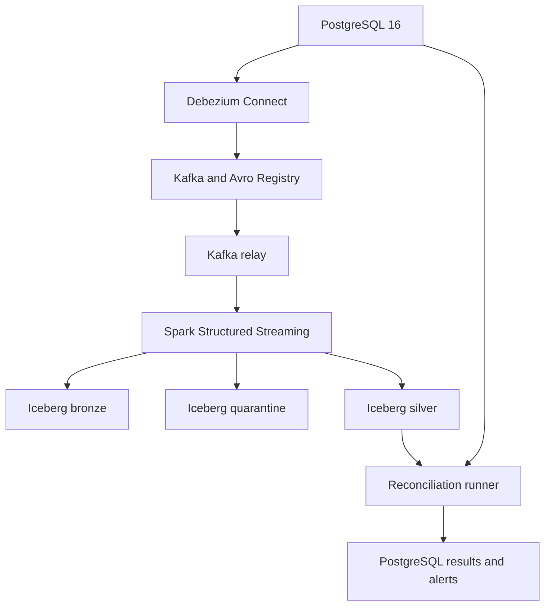

# ParityLake architecture

The integration path starts with PostgreSQL logical replication and ends
with two independently queried states. The diagram reflects the implemented
path. These Docker services have yet to run in this Work session.

Iceberg metadata is served by its REST adapter backed by SQLite on a
named Docker volume. Table files use MinIO. Spark Structured Streaming
offsets are stored through S3A in a separate checkpoint bucket. The
default Compose network publishes no host ports.

The Spark job inserts unseen Kafka offsets into bronze and applies only
newer CDC versions in silver. An Iceberg commit is atomic per table.
Offset-keyed bronze and quarantine inserts and version-guarded silver
merges make retry after a partial batch commit safe for a single writer.
Multiple concurrent writers and PostgreSQL failover timelines need
separate validation. Great Expectations runs on each bounded microbatch.
Decoder errors and rejected records are kept by Kafka offset.

Reconciliation reads current source truth from PostgreSQL in a
repeatable-read transaction and pins the Iceberg main snapshot for all its
queries. Window start is inclusive and end exclusive. Deleted rows
contribute to the delete count and fingerprint. Live rows contribute to
financial totals. Drift creates a durable alert record containing bucket
and exact trip-level evidence. Two independently read stores do not share
a transaction. A late source change can surface as real temporary lag.

The first Docker workflow tests synthetic CDC, restarts the catalog and
resumes the Spark checkpoint before retesting exact source/lake parity.
The public TLC replay is a separate data exercise. The dbt stage builds gold after the recovery check. Timed fault drills and Airflow remain open.
